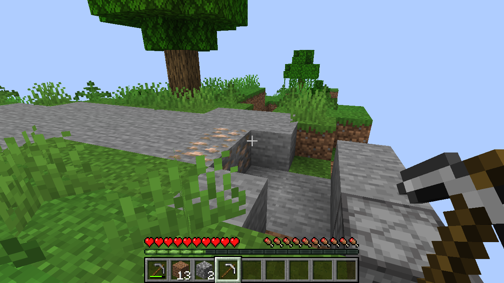

# 眼见为实 · Naked Eye

> 只用肉眼玩 Minecraft 26.3 的 AI 测试场：AI 只能看见、听见人类玩家能看见、听见的东西，不能透视。（非官方项目，与 Mojang 无关）
> Fabric 客户端 mod（Java 25）+ 一份"诚实版" Baritone fork + 给 Agent 用的命令行 `hc`。



这一版做了什么：

- **迁移到 26.3**。Mojang 把一帧拆成了 update → extract → render 三个阶段，无头模式只需要拦截最后的 GPU 绘制。1.21.11 上的光照补丁和加载界面补丁都不需要了，只剩一个小补丁（见下文）。
- **完全不需要 X 服务器**。26.3 改用 SDL3 管理窗口，可以走 SDL 的 offscreen 驱动 + Mesa surfaceless EGL + llvmpipe。
- **可见性模型重写**。移植原版光照着色器计算"看起来有多亮"，读取玩家的亮度设置，再按"越暗越要大才看得见"判定能否察觉；蜘蛛和末影人的发光眼睛能在黑暗中被看到；烈焰人这类自带全亮的生物在黑暗中完整可见。
- **诚实版 Baritone**。它的所有方块查询都改走 Agent 的记忆；转头限速 300°/s；关闭 freeLook（眼睛看一边、身体走另一边）和聊天命令（`#mine` 会扫描原始区块，等于透视）。
- **12/12 验收测试通过**。
- **实际游玩：从空手到铁镐**，不到一个游戏日。

## 验收测试（`tools/verify.py`）

| # | 场景 | 结果 |
|---|---|---|
| T1 | 墙后僵尸 | 看不见（客户端其实知道它的坐标和血量）；拆墙后看见，还能看到它在阳光下燃烧并闪红 |
| T2 | 铁傀儡血量 100/70/45/20 | `{}` / `crackiness: low` / `medium` / `high`，从不出现血量 |
| T3 | 埋着的钻石 vs 露在外面的钻石 | 只记住露在外面的那块 |
| T4 | 遮光玻璃小黑屋 | 黑着时看不见，点上火把后能看见 |
| T5 | 墙后僵尸低吼 | 听见 "Zombie groans"，但看不见 |
| T6 | 身后的牛 | 转身之后才看得见 |
| T7 | 56 米外的羊 | 只知道"有只羊"；近处那只能看出是红色羊毛 |
| **T8** | 封闭大厅（光照 0），僵尸在 4/8/12/16/24 米 | 亮度昏暗：只看到 5.7 米；默认：到 12 米；明亮：到 16 米（与模型预测的约 6/13/23 米吻合） |
| **T9** | 黑暗中 20 米外的蜘蛛 | `only_glowing_eyes_visible`，只看得见眼睛 |
| **T10** | 黑暗中 20 米外的烈焰人 | 完整可见（渲染器给它全亮光照，没有写任何特例） |
| **T11** | 楼梯藏在墙后 | 诚实版 Baritone 走到墙边报告"没有已知路线"；墙上开门、看见楼梯后，它才爬上高台 |
| **T12** | 横向挖隧道，第 5 格后面藏着岩浆 | 挖开的瞬间看见岩浆，任务自己用圆石把洞堵上，血量不掉 |
| **T14** | 牛在面前，我向左转 100°；随后在它面前凭空立起一堵墙 | 转身后报告"从视野**右侧**出去了"；立墙后报告"在视野里消失了（躲到了什么东西后面）"。都附带它当时的移动方向和"现在大概在哪"的猜测 |
| **T13** | 三层测试洞穴，带一处 5 米单向断崖 | 站在崖边时，图上把这处断崖标为 ONE WAY，并提示"下去就回不来"；传送到最深处后，只凭拓扑图边探索边找路，3 轮回到入口（全程禁止挖掘和放置） |

T1a 曾经偶尔失败，最初怀疑是透视漏洞，查下来是测试脚手架的问题：Agent 从远处开始测试时，测试场的区块没有加载，`fill` 命令静默失败，墙根本没有建起来。现在搭场景前会先强制加载这些区块。

关于 T11 的一个插曲：如果背包里有镐和泥土，Baritone 会**用泥土搭一段台阶直接翻墙**。这是完全合法的人类打法，并没有用到墙后的信息。所以 T11 在测试期间会临时关掉 Baritone 的挖掘和放置，只检验"会不会利用没见过的路线"。

## 可见性模型（`Luma.java`）

1. **看起来有多亮**：逐行移植 `assets/minecraft/shaders/core/lightmap.fsh`，包括它两次"向 0.75 灰混合 4%"的保底亮度（所以亮度 0 的矿洞也不是纯黑）和亮度滑块的 notGamma 混合。光照等级 0 在默认亮度下约为正午的 10%。
2. **实体的亮度**直接读取 RenderState 里的 `lightCoords`，也就是渲染器给它上色时实际用的光照值，再按天空变暗程度换算。
3. **能否察觉**：需要的屏幕尺寸 ∝ 亮度^-1.5（近似 de Vries–Rose 定律）。标定结果：白天一只怪在 200 格外就能察觉；月夜约 30 格；无火把矿洞约 13 格；"昏暗"亮度下的矿洞约 6 格。
4. **发光眼睛**：通用地检查渲染器有没有挂 `EyesLayer`。有的话，即使身体太暗看不见，眼睛按全亮计算。

## 实际游玩记录（Claude 只用 `hc` 命令）

```
06:00  出生在稀疏丛林（空手）
       hc go → 白桦树下 → 砍出 4 根原木 → 木板 / 工作台 / 木棍
       放工作台失败：目标格和自己的碰撞箱重叠 0.08 格（物理规则，人也放不进去）→ 换个格子 → 木镐
       远处看到地表的石头 → hc go → 挖到 3 块圆石 → 就地再做一张工作台 → 石镐
       石头旁边露着铁矿和煤矿 → 挖开后矿脉又露出 2 块 → 粗铁 ×3、煤 ×1
日落   挖阶梯凑够熔炉用的圆石（Agent 自己写的 staircase.py / gather.py）
夜里   走回工作台做熔炉 → 打开熔炉界面：粗铁放上格，煤放燃料格（字幕："Furnace crackles"）
       约 30 秒后取出 3 块铁锭 → 木棍 + 铁锭 → 铁镐 ✅
```

## 第二局：挖钻石（3 条命，第 3 条命挖到）

| 命 | 经过 | 死因 / 结局 | 当场改的代码 |
|---|---|---|---|
| 1 | 让 Baritone 用"岩石先验"直接下挖到 y=-58 | 挖穿进地下水，Baritone 判断"没有路"后**就停在水里**；大脑 60 秒一次轮询，还没醒就淹死了 | 水下自动上浮反射（默认开，可关）；等待时一受伤或掉气就提前叫醒大脑；`hc watch` |
| 1½ | 跑回死亡点捞回铁镐，自己写阶梯任务挖到 y=2 | 铁镐在半路**用坏了也没发现**，空手又挖了几十格 | 背包显示耐久；工具快坏时自动换备用镐，没有备用就停下 |
| 2 | 下到 y=-58 支线挖矿，看见岩浆就停 | 停下时岩浆**已经在流进来**（流 1 格约 1.5 秒，比一次大脑往返还快），被烧死 | 挖开的格子一碰到液体，任务**当场用圆石堵洞**（T12） |
| 3 | 木头 → 石镐 → 一路"顺手"挖煤铁 → 熔炉 → 铁镐 → 阶梯下到基岩 → 支线挖矿 | **y=-59 看见 `deepslate_diamond_ore`，铁镐挖下，钻石 ×1** 💎 | 见下 |

第 3 条命里修掉的坑：

- **测试规则泄漏**：验收测试把 `spawn_mobs` 和 `advance_time` 设成 false 后没有恢复，所以前两条命其实**没有刷怪、也没有昼夜交替**。现在测试结束后会恢复，也会把 Agent 送回原位、还回借用的快捷栏。第 3 条命是在正常规则下打的（夜里在地面被打掉了 3 颗心）。
- **Baritone 拿了泥土就不放下**：之后的挖掘全是空手，挖了 30 块石头一块圆石都没掉。现在挖掘会自动换到快捷栏里**能掉落、又最便宜**的工具（不会拿铁镐去挖石头）。
- **Baritone 自带的自动换工具会挑最快的**，下矿路上把铁镐磨掉了 18%。所以赶路时把铁镐放在背包里，并且把"挖一格"的额外代价从 2 提到 8，让它优先走已经挖好的隧道。
- **放方块**：新增 `place` 任务，自动找一个看得见、也够得着的支撑面。踩过的坑：点到落叶堆这类**可替换方块**时，方块会直接替换掉它，而不是贴在它旁边。
- **扔东西**：站着扔掉的东西 2 秒后会被自己捡回来（这是真实的游戏机制）。现在先转身往后扔，然后马上往前挖走。
- **钻石矿用石镐挖会直接碎掉**：顺手采矿时，会跳过手上工具挖不了的矿。
- **视觉中央凹**：盯着看的 ±5° 范围里会额外加密采样。原来远处地上一块方块只有约 13% 的概率被采样射线命中，T3 因此偶尔失败。
- 事件流会合并连续重复的条目，挖矿时连续几十条"Block breaking"会折成一行。

新增命令：`hc stairs/tunnel 方向 步数 [停止条件] [顺手挖的矿]`、`hc goy Y [停止条件]`、`hc place X Y Z 物品`、`hc drop 物品,…`、`hc watch`。另外有一个 `agent/branch.sh`，每挖 12 格插一根火把。

## 洞穴拓扑图（`Places.java`、`Sonar.java`）

我读 ASCII 地图找路的能力不可靠，研究里也有模型在 ASCII 地图导航上 0% 成功的结果。所以给大脑的不是三维体素，而是"哪儿通哪儿"：

```
$ hc cave
AROUND ME (facing north):
  ahead (north)  walkable 6 m, then DROP 5 m at 7 m (bottom never seen)
  …
P0 (HERE)  around me, 22 floor cells, floor y 164, lit
     ↓ drop ~5 m to P2 — ONE WAY (fall damage ~2); ↔ P1
P2  7 m east (right), 5 m below, 53 floor cells, floor y 159, lit
     ↑ P0 is 5 m up — can't walk up, need to pillar/dig stairs
     route from here: P0 → P2   ⚠ NO WAY BACK on foot once there
     F0: unexplored opening on the south side …
MARK entrance: 17 m west (behind-left), same level — reachable (P1)
```

- **站位格**：脚下是实心方块、身体和头部两格都已知是空的。只用 KnownMap，没见过的就是没见过。
- **地点**：在能双向走通的格子之间从种子点向外生长，范围限制在 ±10 格内。这样一个房间是一个地点，大洞穴会被切成几块。
- **连接**：标明双向走、单向跳下（附落差和摔伤）、或者要垫方块才能爬上去。站在崖顶时看不见紧贴墙根的崖底，所以落点改用前方 2–5 格处可见的地面来推断，标上 `~` 表示是估计。
- **未探索出口**：从每个站位格出发，沿已知空气扩散 3 步，碰到从没见过的格子就记一个出口，再按方向聚类。
- **方向**同时给出东南西北和"前后左右"，大模型最容易在参照系转换上出错，这里直接替它换算好。
- 命令：`hc cave`、`hc sonar`、`hc goto P3|F1|标记名`、`hc mark`、`hc unmark`。`agent/find_way.py` 是"认得路就回家，不认得就去最近的出口看一圈"的循环。
- 环顾四周依次转三圈：平视、低头、抬头。原来只平着转一圈，看不到往下走的楼梯。

## 录像（ServerReplay → ReplayMod）

服务器现在是 Fabric 26.3，装了 **ServerReplay 3.6.0**。Agent 一上线就自动开录，下线时存成 `server/recordings/players/Agent/<时间>.mcpr`。在 Mac 上装 **ReplayMod 26.3-2.6.28**，把文件放进游戏目录的 `replay_recordings` 文件夹就能回看，可以自由视角，也能渲染成视频。注意录像是服务器视角：你看到的比 Agent 当时"看见"的多。启动脚本是 `start_server.sh`。

## Baritone fork：挑最便宜又够用的工具

原版 Baritone 本来有"同样快就挑材料更便宜的工具"这条逻辑，但它拿镐本身去匹配修复材料标签（圆石、铁锭这些），永远匹配不上，所以这条逻辑从来没生效过。fork 新增 `preferCheapestAdequateTool`：在能挖掉、又真能加速的工具里，按耐久上限从低到高挑。实测挖深板岩时，铁镐耐久一直停在 57%，磨损全由石镐承担。另外开了它自带的"工具快坏时不用"选项（`itemSaver`）。

## 第三局：向下界进发（还没到）＋ 一大串系统改进

这一局一共死了 6 次，都死在被包围、射死、挨饿、闷死这些"大脑反应不过来"的情况上，还没走到下界。不过一路上把系统改了一大圈：

**暂停（相当于 ESC）**
- `pause-mod/`：一个很小的 mod，服务器和客户端都要装。原版的 `/tick freeze` 会**特意放过玩家**（`isEntityFrozen` 里写死了"是玩家就不冻"），玩家照样窒息、挨饿、走动。这个 mod 把玩家也一起冻住，同时让服务器那边逐个玩家的更新也停下来。实测：冻结 8 秒，头上压着沙砾也不掉血、不掉饱食度、位置不动。
- 客户端遇到这些情况会自动暂停（`/tick freeze`，走实验者的 RCON 通道，Agent 自己没有 OP 权限）：受伤、气泡掉一半、着火或进了岩浆、5 格内出现看得见的敌对生物。
- **只有大脑有意发出的动作才能解除暂停**：`hc` 手动命令会自动带上 resume 标记；脚本的动作会被拒绝，脚本随之退出。原来砍树脚本会一路点穿暂停，被骷髅射死过一次。
- 重启客户端之前先冻结世界，新客户端上线时接管这个暂停。`hc pause off` 是"多人模式"，此时只剩反射兜底。
- 受伤原因写在暂停信息里，都是人类玩家能看到的线索：头卡在方块里、着火、身上插着几支箭、受击时画面往哪边歪（原版的 `hurtDir`）、被击退的方向、身边有哪种怪。

**战斗（`Fight.java`，`hc fight`）**：跳劈（趁冷却快满时起跳，下落时出刀）＋ 自动挑武器 ＋ 低血量时交还控制权。擂台实测（`tools/combat_test.py`）：
- 对 2 只僵尸：站桩砍平均剩 10–13.5 颗心，跳劈剩 12.8，后撤反而更差（9.8），所以默认不后撤。
- 对 2 只骷髅（21 米外，每种打法 8 轮）：骷髅只瞄你**当前**的位置，不算提前量（代码在 `AbstractSkeleton.performRangedAttack`）。⚠️ 最初几轮骷髅测试**全部作废**：用 `/summon` 带 NBT 召唤会跳过自然生成时的初始化，骷髅**手里根本没有弓**，测到的其实是空手骷髅。给它们配上弓之后重测：直线冲平均剩 14.4 颗心；全程之字形 14.0，波动很大，还死了一次；看到拉弓就在脚前放 1 格方块 15.1，最差的一局也剩 14。骷髅瞄的是身体 1/3 高度处，所以 1 格就能挡住，而且能直接跳过去。现在默认开启放方块（`nowall` 可以关掉）。
- **瞄准模型**：不再用每 tick 15° 的硬上限。大角度转身按 Fitts 定律算耗时（30 ms + 50 ms·log₂(1+角度/5°)），速度走最小加加速度的钟形曲线，转 90° 约 0.25 秒、转 180° 约 0.3 秒，不会瞬间转过去。小角度修正用平滑跟随。参数可以用 `-Dhonest.aim.a/b` 调。服务器移动了视角（传送、复活）时，会丢掉还没转完的目标。

**其他新工具**：`hc recall 方块`（我记得在哪见过它）、`hc scoop`（按桶的射线规则舀水或岩浆）、`hc open`（确认准星真的落在方块上再点）、`hc place 物品`（自动在身边找一个能放的位置）、`hc spiral`（3×3 螺旋楼梯）、`hc goxz`（只给水平目标，用"地面大概会延续"的先验走进没见过的地方）、`agent/explore.py`、`agent/bootstrap.sh`。视觉里能分清静水和流水；挖掘任务只在碰到岩浆和静水源头时堵洞。

**踩到的大坑**：
- 记忆文件不是原子写，客户端在保存时被杀，留下半截文件，200 万条记忆丢到只剩 63 万。现在先写临时文件再改名。
- 加载 500 万条记忆时，哈希表按遍历顺序插回一张逐步扩容的表，严重聚集，**启动从 35 秒拖到 150 秒以上**，最后干脆卡死。加载前预分配容量就好了。
- 验收测试改的游戏规则（关刷怪、关昼夜）泄漏到了正式游玩里，测试搭场景的 `fill` 在没加载的区块里静默失败。现在恢复规则后立刻存档，搭场景前先强制加载区块。
- Baritone 自带的区块缓存相当于透视，现已关闭。


### 物体恒存（`Sightings.java`）
看着的东西从视野里消失时，人知道它大概去了哪儿，观察结果里的 `recently_lost_sight_of` 就是干这个的。判断方法是：拿它最后一次被看到的位置，放到**当前**的屏幕上比一比。在屏幕外，就说是"从视野左侧/右侧/上方/下方出去了"（不管是它自己走出去，还是我转头把它甩出去，都算）；仍在屏幕内却看不见，就说是"躲到了什么东西后面"；如果实体已经不存在了，就说是"在视野里没了（死了或消失了）"。同时附上看到的移动方向，和一个**明确标注为猜测**的当前位置（按原速度外推，最多外推 1.5 秒）。记忆保留 10 秒，时间按游戏时间算，暂停时不往前走。

### 手动逐帧对战骷髅：学到的东西（`HC_FRAME=1 hc ...` + `hc step N 按键...`）
世界保持冻结。我看一眼局面、给一个输入，用 `/tick step N` 放行 N 个 tick，再冻结，就像格斗游戏练招时的逐帧播放。箭矢追踪器（实验者接口 `/debug/arrows`）会记录每一支箭的下场。
- 先说更正：之前的骷髅擂台测的是**空手骷髅**。`/summon` 带 NBT 召唤时，不会走自然生成那一步，所以骷髅不拿弓。
- 在 16 米外，骷髅不会理你。拉弓大约 18–20 tick，射完到下一次拉弓有 28–44 tick 的空档。
- **在开阔地追不上骷髅**：你一靠近（大约 11 米以内）它就边退边横移，我疾跑逼近时，实际只能以每 tick 0.05–0.15 米的速度缩短距离。所以"抓住空档冲过去"在平地上基本冲不到脸上。
- 只要**一直面朝它**，盾牌能稳稳挡住正面来的箭。真正挨打，都是因为它横移出了视野，我丢了目标，箭从侧面射进来。
- 拿 15 次中箭做了统计：几乎全是在 2–3 米处贴脸对砍时中的。往冲锋路上放方块，挡住的箭数是 0。
- 下一步的方向：**持续盯住它**（视野跟踪比怎么接近更重要），举盾慢慢往前顶；借地形或掩体把它逼进角落，利用它的空档挥斧。

## 第四局：通宵冲下界（没进成，死到第 21 次）

**结果**：两次凑齐了进下界的全部材料（钻石镐、≥10 块黑曜石、打火石），两次都死在最后几步：一次是骷髅骑兵，一次是废弃传送门边的火和岩浆，材料全丢。最好的一条命做出了钻石镐、钻石剑、钻石胸甲 + 靴子，一共挖到 14 + 9 + 5 颗钻石。

**死因统计（第 7–21 次）**，这次是按机制分的类：
- 战斗中残血还在原地站着（战斗任务的"低血就交还控制"实际上是站桩）× 3 → 现在改为举盾、面朝敌人后退
- 苦力怕 × 3（看不见 / 不看膨胀状态 / 听到嘶嘶声后暂停再决策，来不及）→ 膨胀进了感知；有膨胀的苦力怕或听到嘶嘶声就自动后退（反射，不暂停）
- 岩浆、火焰 × 3 → 挖方块前若记得背后有岩浆就拒绝挖；脚下是火或岩浆就跨出去；进岩浆或着火时自动往脚下倒水桶（实测掉进岩浆坑只损失不到 1 血）
- 雷暴劈出的骷髅骑兵 × 3 → 感知加上了天气（下雨 / 雷暴）
- 摔死 × 2（追猪追下悬崖；挖楼梯时被惯性带下崖）→ 追击前检查落脚点；踏上新台阶后改为潜行
- 夜里重生，空手，被围 × 4 → `/tmp/hole.sh`：挖 3 格下去，再把头顶封上

**加的能力**
- 瞄准：方向精确到 0.1°（距离仍是估计值）；`look_at_entity`、`track`（锁定，带延迟、增益 < 1、手抖和慢慢游走的瞄准点）；**所有转动都按鼠标整数格走**（参考 LiquidBounce 源码；之前每次转动都不是整数格，反作弊一眼就能认出）
- 挖矿：每 8 格插火把（之前一直放不出来，因为左键还按着，游戏会忽略右键）；单格坑自动垫方块；`hc upstairs` 往上挖楼梯；快坏的工具不再被选中
- 放置：只尝试**射线真的能照到**的面，每个面试 5 个点，失败就换下一个格子（`PlaceAny`）
- 水下视野：海带、海草能被看见，头在水下时能看约 12 格
- 丢东西：改为手持物品按 Q（原来打开背包点 THROW 的方式在这个服务器上失效了）
- 战斗中不因挨打而暂停；着火时不再每秒暂停一次；挑武器会看整个背包，按材质排序
- Baritone：饱食度 < 16 时不疾跑；禁用水桶落地（MLG）；永远不拿剑挖方块

**还没解决、我认为最关键的问题**：大脑一次决策的周期太长（几秒到几十秒），而这个世界出生点附近树冠很密，白天树荫下也刷怪，再加上缺吃的、缺床。光靠反射一个个打补丁，治标不治本。真正需要的是一个常驻的"小脑"：自动处理吃东西、背包、躲避、反击和找掩体，大脑只负责决定目标。

## 第四局之后：思考时按 ESC、3 倍速、剪掉回放里的思考时间

**更正上面的结论。** 病根是"想的时候世界还在跑"，用不着专门造一个"小脑"：单人模式下，人本来就可以随时按 ESC 停下来想多久都行。现在**动作一结束世界就冻结，下一条命令一到才解冻**，世界只在我"动手"时才走。

- **空闲暂停**（`Pause.java`）：没有动作在执行、没有任务在跑、没有按住的键、镜头没在转、反射也没在动，满 3 tick 就冻结。这种"思考暂停"任何动作都能解除，脚本也可以，所以连续发命令的脚本不受影响；告警暂停仍然只认大脑手动发的命令。`hc pause idle off` 可以关掉。T16 测它：想 2 秒，世界走了 0 tick。
- **3 倍速**（`hc speed 3`）：用的是 `/tick rate 60`。这个速率会同步给客户端，两边一起加速，相对速度不变。`/tick sprint` 不行，它只让服务器狂奔，客户端还是每秒 20 tick，等于给怪物开了 N 倍速。动作等待和点击限速都改成了按游戏 tick 计时。客户端跟不上时（只统计世界在跑的时段）会自动降回原速。这台 2 vCPU 的机器上，60 tps 两边都稳；100 tps 时客户端只有 45–54，掉队了。上面"能跟到 198 t/s"是在负载很轻时测的。
- **回放剪辑**（`tools/replay_cut.py IN.mcpr`）：ServerReplay 的玩家录制器只有 Flashback 格式支持暂停，但每次冻结和解冻都会录下一个状态包（协议 777 里是 0x82）。脚本按这些包把冻结的时间段压缩到 0，期间的区块和方块更新照样保留。实测一段 169 秒的录像剪到 16 秒。**还没在 ReplayMod 里实际打开过。**
- **防溺水反射**：按住潜行表示"我在主动下潜"，反射原来会让路，现在气少于 1/4 时由反射接管。

**已知问题**：在全新世界里第一次跑完整的 verify 时，T13（洞穴里找路回家）偶尔会失败，有一次 T4（暗室里的僵尸）也失败过。重跑通常就能过，全新世界里单独跑这两项也都能过，所以和测试顺序、第一次生成区块有关。还没定位到具体原因。

**观战（`pause-mod/…/Watch.java`）**：用原版客户端连进服务器，就会附身到 Agent 身上：镜头是它的，HUD 和物品栏通过数据包同步过来，客户端被告知处于冒险模式，所以会画出生存模式的界面；服务端那边你始终是真正的旁观者，发出的所有操作都会被丢弃。按潜行脱离，脱离后可以自由飞；`/watch` 回去；Agent 重生后自动跟回去。Agent 那边看不到观众的实体，也收不到加入提示；世界冻结时观众不受影响。纯原版客户端实测能连上，能持续跟随。

## 复盘：从录像重建任意时刻的两种视角（`tools/review.py`）

录像（ServerReplay）里有服务器发给 Agent 客户端的每一个包；旁路日志（`run/client/flightlog/*.jsonl`）里有从没离开过客户端的东西：每 tick 的精确位姿、AI 收到的每份观察、每条命令和结果、所有事件，以及它边玩边写的解说（`hc note`，也会显示在观众的动作栏上、录进录像）。

`tools/review.py open` 开一个假服务器（`tools/replay_server.py`），把录像的包原样喂给一个"复盘模式"的客户端。这个客户端站在 Agent 当时站的位置、看着它当时看的方向，跑的是同一套感知代码。所以 `review.py agent` 给出的是"它当时能感知到什么"，这是重新算出来的，不是靠回忆；`review.py god` 给出的是"实际上周围有什么"，并标出每个实体它看见了没有。`goto GAMETIME` 可以跳到任意时刻（只能往前；要往回就重开），暂停时客户端的世界也会冻结。`report` 会给每次死亡生成一份"死前 N 秒"的报告：说了什么、做了什么、听到了什么，以及死前 2 秒两种视角的对照。

实测：用实盘日志里记下的观察做对照，重放算出来的视角基本一致，残留的差异来自跳转精度（0–3 个 tick）。

录像现在在录制时就跳过了冻结的时间（`RecordingClock`）：只是录像的时钟停走，冻结期间的包照录。每次想了多久记在服务器日志里，总和在录像元数据的 `accumulated_paused_time`。`hc speed auto` 会自动找出机器能稳住的最高倍速；这台 2 vCPU 的机器能到 5 倍，因为 Agent 客户端现在完全不绘制画面。

## 一台机器多个实例；同一个世界多个 Agent（接口已留）

- **各玩各的**：一份仓库副本就是一个实例。`tools/ports.py` 给每份副本分一个槽位，所有端口整体 `+100 × 槽位`，游戏文件共用 `~/.cache/naked-eye`。用法见 `PORTABLE.md`。
- **同一个世界多 Agent**：`./add_agent.sh 名字` + `HC_AGENT=名字 tools/hc …`。服务端每秒重读一次 `agents.txt`，新名字自动算作 Agent，不当成观战者；录像会给它单独开一条。**时间模型已经定了，也写好了**（`Clock.java`，服务端）：所有 Agent 都在动，世界才走；有一个在想，世界就停。以前是各个客户端自己用 RCON 冻结、解冻，现在改成客户端只向服务端报告"我按住世界"或"我松手"，由服务端统一裁决，单 Agent 只是 N=1 的特例。配套改动有三处：等待改按世界真正走过的 tick 数（客户端在冻结期间照样每秒跑 20 tick）；动作等待不再有墙钟超时；查看类的请求在动作等待期间也能照常应答；新动作一到，就把还在等待的旧动作结束掉（hc 被杀掉之后，它留下的等待不会再堵住下一个决定）。测试在 `tools/verify_multi.py`。思考上限是 `rules.properties` 里的 `think_limit_seconds`，默认不限。"任何人在想世界就停"其实就是一种回合长度不固定的回合制：世界每次只跑到下一个 Agent 的动作结束。它和固定回合（每轮固定 N tick）真正的区别在于**决策频率**：前者谁把动作切得越碎，谁的反应机会就越多，而且思考不花游戏时间，等于白拿；后者每个 Agent 每秒的决策次数相同。但这并不构成不公平：切碎动作不花游戏时间，谁都可以这么做，大家都切到 1 tick 时，就成了最公平的逐 tick 锁步。代价只是墙钟时间。另外，Agent 已经可以无限期思考，再用"最短动作时长"去模仿人的反应时间，就是自相矛盾。所以采用"任何人在想世界就停"，墙钟效率由思考上限来管（见上）。
- **聊天和分队**（`Talk.java`、`Chat.java`、`Teams.java`）：公屏、队内（`/teammsg`）、私信（`/msg`）都是原版机制，分队来自 `teams.txt`。收到的消息直接读原版的聊天类型，知道是谁说的、哪个频道、发给谁，不解析文字。聊天默认免费：在冻结的世界里也能随便聊，好看 AI 们为一个目标商量起来。打开 `chat_takes_time` 后，按连麦语速算时间，消息说完才送达。新消息会唤醒正在等待的 Agent。所有聊天都存进 `run/server/chat/*.jsonl`（`tools/chat.py`），观战者能看到队内消息和私信，Agent 被禁止通过游戏以外的方式交流。
- **看见别的玩家**：名牌按原版规则显示，64 格内可以透墙、在黑暗里也能看到，对方潜行时就看不到了；观察结果里还有 Tab 名单和自己的队伍。死亡画面上的 Agent 也算"在想"，世界会等它决定是否重生。
- 修了一个 bug：一个 Agent 如果曾被当成观战者（比如它在线时被暂时移出名单），旁观者模式会存进它的存档，之后就一直是旁观者。现在 Agent 一律改回生存模式。
- **伤因不再靠猜**（`Hurt.java`）：以前是拿字幕字符串（"falls on a block""Explosion"）加上 fallDistance 拼出来的，又脆又不准。现在直接读服务器每次伤害都会发给客户端的伤害事件（`ClientboundDamageEventPacket`，原版靠它决定屏幕往哪边歪），里面有伤害类型、攻击者和来源位置。对 Agent 的规则：伤害类型直接告诉它（人总知道自己是摔的、烧的还是饿的，死亡信息也会写明）；攻击者只有这一刻在画面上才说出名字，判断标准和 `obs` 是同一套。看不见的分三种说：off-screen（转头就能看到）、right in front of me that I can't make out（就在画面里，但太暗、被挡住或者隐身），以及远程攻击的 not in view（箭从哪里来，不等于射手站在哪里）；方向只给八个方位之一，相当于屏幕歪的那一下。测试见 T17。
- 同时堵住了一个旧漏洞：原来的"a zombie right next to me"只检查有没有东西挡着，不检查视野，所以背后的怪也会被报出来。

## 这一版踩到的坑

1. **26.3 的加载界面**：要等"玩家所在区块编译成 GPU 网格"才会关闭，超时后兜底放行。无头模式下网格永远不会生成，所以用 `LoadTrackerMixin` 直接放行。区块数据其实已经到了，只是缺 GPU 网格。
2. **单击在 26.3 上失效**：换成 SDL 之后，`InputConstants.getKey(按键名)` 返回的键对象对不上实际绑定的键，于是 `KeyMapping.click()` 什么都没点到。改为直接给对应的按键映射加一次点击计数。长按一直正常，所以挖掘没受影响。
3. **更正一个旧结论**：1.21.11 版 README 里写的"攻击冷却 8 分钟"是误诊。冷却在**松开左键**时就会清零，当时真正的原因是加载界面卡住了。多余的 mixin 已经删掉。
4. **客户端 tick 下限**在 26.3 里依然是 `Math.max(50ms, …)`，所以继续用补丁去掉它。服务器保持 20 TPS 时，补丁返回的值和原版完全一样。实测：服务器加速到 200 t/s 时，客户端能跟到 198 t/s。

## 文件

- `setup.sh` / `start.sh` / `stop.sh` / `window.sh` / `add_agent.sh`：下载、启动、停止、开关游戏窗口、往世界里再加一个 Agent。`tools/ports.py`：本副本的端口槽位。`launcher/mc.py` 是启动器，只用 Python 标准库。
- `src/mod/`：客户端 mod（感知、动作、反射、暂停）；`src/pause-mod/`：服务端 mod（真暂停、附身观战）。改完用 `tools/build.sh` 编译，jar 会放进 `mods/`（需要 Java 25 和网络）。
- `mods/`：编译好的三个 mod。其中 `baritone-honest.jar` 是改过的 Baritone（LGPL-3.0），源码在子模块 `src/baritone`，同时附了 `baritone-honest.patch`。许可证说明见 `THIRD_PARTY.md`。
- `tools/hc`：Agent 的命令行；`tools/verify.py`：验收测试（实验者用）；`tools/verify_multi.py`：多 Agent 的测试（时钟、聊天、名牌、死亡；会临时再启动一个客户端）；`tools/chat.py`：读 Agent 之间的聊天；`tools/rcon.py`：实验者的 RCON；`tools/replay_cut.py`：剪掉录像里的思考时间；`tools/make_packages.sh` / `make_drive_parts.sh`：打联网版、离线版和小分段。
- `agent/`：Agent 自己写的脚本，只调用诚实 API；`agent/claude-scripts/`：Claude 玩的时候顺手写的小工具。
- `config/`：首次运行时用到的模板（客户端选项、服务器配置、Agent 名单 `naked-eye/agents.txt`）。
- `AGENTS.md`：给任何一家 AI 看的说明和规则；`.claude/skills/naked-eye-playbook/`：Claude 的打法手册。

## 在你自己的 Mac（或任意 Unix）上运行

看 `PORTABLE.md`：`./setup.sh && ./start.sh && tools/hc obs`。启动器在 `launcher/mc.py`，只用 Python 标准库，不需要 Gradle。打包脚本是 `tools/make_packages.sh`。
